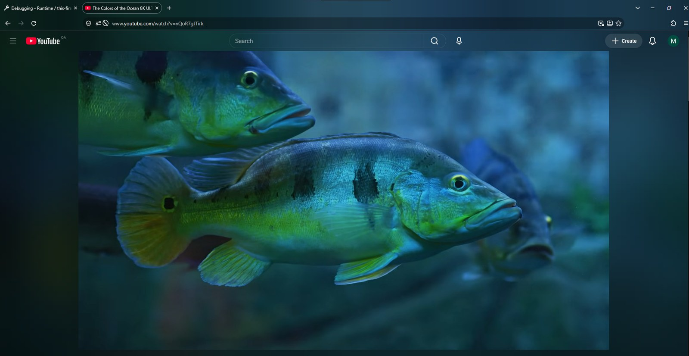
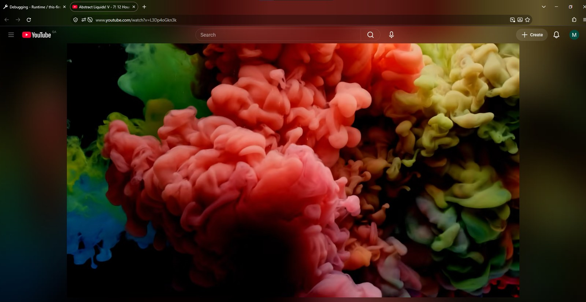
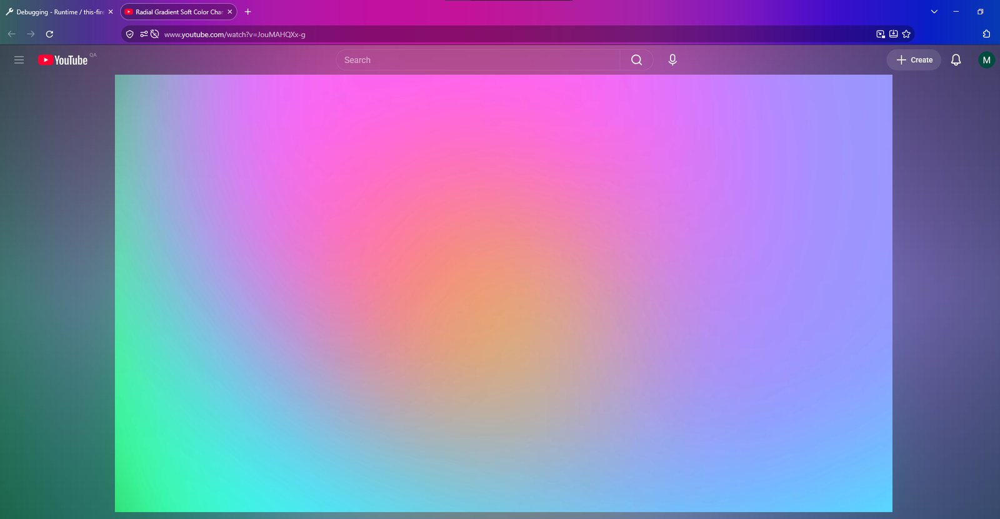
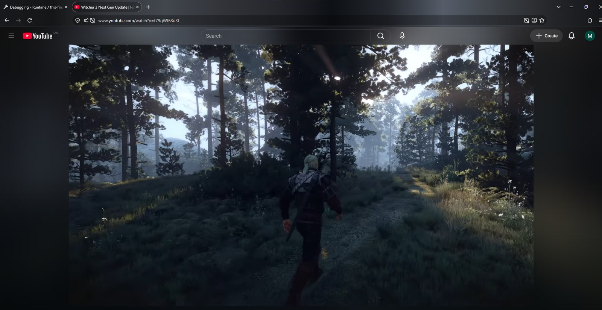
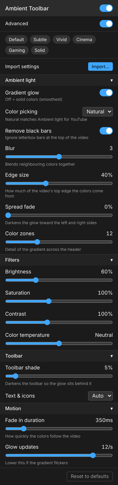

# Ambient Toolbar for YouTube

A Firefox add-on that tints the tab bar and toolbar to match the YouTube video you're watching.

[Install from Firefox Add-ons](https://addons.mozilla.org/firefox/addon/ambient-toolbar-for-youtube/) · [Website](https://mhmd-ra.github.io/ambient-toolbar/) · [Changelog](CHANGELOG.md) · [Report an issue](https://github.com/mhmd-ra/ambient-toolbar/issues)

[](https://addons.mozilla.org/firefox/addon/ambient-toolbar-for-youtube/)
[](https://github.com/mhmd-ra/ambient-toolbar/releases/latest)
[](LICENSE)



| | | |
|---|---|---|
|  |  |  |

## Overview

While a video plays, Ambient Toolbar samples the colors along its top edge and applies them to the Firefox window theme as a left-to-right gradient. The browser chrome reads as an extension of the picture instead of a frame around it. When you pause, it holds the last color; when you leave the video or switch tabs, your own theme comes back.

It runs entirely in the browser. Nothing is collected, stored remotely, or sent anywhere.

## Features

- **Gradient or solid tint.** A gradient that follows the colors across the top of the frame, or a single averaged color.
- **No flicker.** The gradient is drawn as a 1 px strip and double-buffered, so Firefox never paints a blank frame between updates.
- **Letterbox detection.** Black bars at the top of the video are skipped so widescreen films don't darken the toolbar.
- **Readable text.** Tab and icon colors switch between light and dark based on the tint.
- **Watch pages and Shorts.** Muted previews on the home page are ignored.
- **Tunable.** Blur, edge size, spread fade, brightness, saturation, contrast, color temperature, toolbar shade and update rate, with seven presets.
- **Pairs with Ambient light for YouTube.** Defaults are calibrated to continue its glow, and its settings export can be imported directly.

## Installation

**Firefox Add-ons (recommended).** Install from [addons.mozilla.org](https://addons.mozilla.org/firefox/addon/ambient-toolbar-for-youtube/). Updates are automatic.

**From source.** See [Development](#development). Release builds on GitHub are unsigned and intended for review or local testing; regular Firefox only installs signed add-ons, so use the AMO listing for everyday use.

Requires desktop Firefox 142 or later.

## Configuration

Open the toolbar button, or go to **Add-ons and themes → Ambient Toolbar → Options**. Changes apply immediately, including while the video is paused. Enable **Advanced** to show every option.



**Presets:** Default, Recommended, Subtle, Vivid, Cinema, Gaming, Solid.

**Import / Export:** back up or share your settings as a file, or import an Ambient light for YouTube export.

| Section | Setting | Effect |
|---|---|---|
| Ambient light | Gradient glow | Gradient across the header; off uses a solid color |
| | Color picking | *Natural* (plain average) or *Vivid* (weights brighter areas) |
| | Remove black bars | Ignores letterbox bars at the top of the frame |
| | Blur | Blends neighbouring colors |
| | Edge size | How much of the frame's top edge is sampled |
| | Spread fade | Darkens the gradient toward the window edges |
| | Color zones † | Number of color stops across the header |
| Filters | Brightness, Saturation | Overall intensity |
| | Contrast †, Color temperature † | Punch and warm/cool shift |
| Toolbar | Toolbar shade | Darkens the toolbar so the tint sits behind it |
| | Text & icons | Auto, light or dark |
| Motion | Fade in duration | How quickly colors follow the video |
| | Glow updates † | Redraws per second; lower it if you see flicker |

† Advanced

<br clear="right">

## Using it with Ambient light for YouTube

[Ambient light for YouTube](https://github.com/WesselKroos/youtube-ambilight) adds a glow around the video on the page. With both installed, the glow continues up into the tab bar and toolbar. Ambient Toolbar also works on its own.

- The default settings are calibrated to match Ambient light's glow.
- **Import / Export… → Import** accepts an Ambient light settings export and converts its edge size, spread, fade and black-bar settings.
- [`presets/`](presets) contains the tested pair of settings used for the screenshots. The **Recommended** preset applies the same values in one click.

Ambient Toolbar is an independent project and is not affiliated with Ambient light for YouTube or its author.

## How it works

Firefox doesn't let add-ons draw inside the browser toolbar, but it does let them change the window theme.

1. **Sample.** `content.js` downscales the top of the playing `<video>` (minus any black bars) to a small canvas, 12×4 px by default, using `requestVideoFrameCallback`, roughly 20 times per second.
2. **Smooth.** Colors are eased over time so scene cuts blend rather than jump.
3. **Apply.** `background.js` grades the colors with your settings and calls `browser.theme.update(windowId, …)` for that window only.
   - *Solid mode* changes only theme colors, which repaint without flashing.
   - *Gradient mode* renders a 1 px tall strip tiled down the header. Each new strip is layered over the previous, already-decoded one, so there is never an empty frame.

## Development

Requires Node.js and Firefox.

```sh
git clone https://github.com/mhmd-ra/ambient-toolbar.git
cd ambient-toolbar
npm install
npm start        # run Firefox with the add-on loaded; reloads on save
npm run lint     # Mozilla add-on linter
npm run build    # package to dist/
```

Without Node, open `about:debugging#/runtime/this-firefox`, choose **Load Temporary Add-on…**, and select `extension/manifest.json`.

```text
extension/         the add-on (packaged as-is)
  manifest.json
  content.js       samples the video on youtube.com
  background.js    grades colors and updates the theme
  settings.js      defaults and presets
  popup.html/js    settings panel (toolbar popup and options page)
  import.html/js   import / export page
presets/           matching settings for Ambient light and Ambient Toolbar
docs/              website (GitHub Pages)
store/             addons.mozilla.org listing text
```

Bug reports and pull requests are welcome. Please open an issue first for larger changes.

## Known limitations

- DRM-protected videos (some films and rentals) can't be sampled; the toolbar stays unchanged.
- A custom Firefox theme is replaced while a video plays and restored afterwards.
- Firefox rate-limits theme updates, so the tint is smooth but not as immediate as an in-page effect.

## Privacy

The add-on makes no network requests and stores settings only in Firefox's local extension storage. See [PRIVACY.md](PRIVACY.md).

## Acknowledgments

Developed with assistance from [Claude](https://claude.ai) by Anthropic.

## License

[MIT](LICENSE) © 2026 mhmd-ra. YouTube is a trademark of Google LLC; this project is not affiliated with or endorsed by Google.
